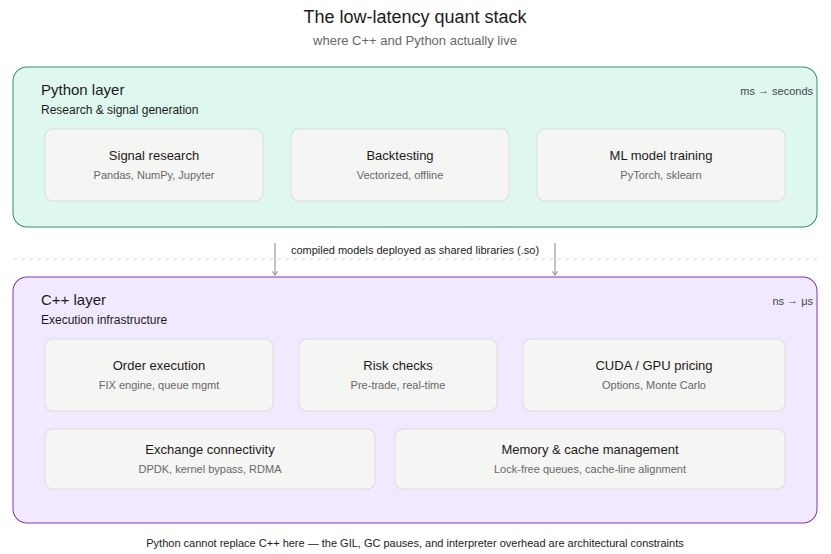

_While the industry obsesses over Python and LLMs, the engineers who actually move markets are doubling down on C++._

Every few years, someone publishes a piece declaring C++ dead in finance. Python won, they say. AI will handle the rest. You can build a strategy in a Jupyter notebook and call it a day.

That's a comfortable narrative. It's also wrong - and the people saying it usually aren't the ones responsible for microsecond-level execution.

> Latency doesn't care about your productivity argument.

## Where Python actually ends

Python is genuinely excellent for research, signal prototyping, and data wrangling. No one serious disputes that. But the moment a strategy needs to live in production - co-located, competing for queue priority at the exchange level - Python's runtime overhead becomes a liability, not a minor inconvenience.

The GIL, garbage collection pauses, and interpreter overhead are architectural constraints, not version problems. You can't pip install your way out of them.

## What's actually driving C++ demand right now

Three things are making C++ more relevant in 2026, not less:

1. **CUDA and GPU-accelerated quant.** The AI boom didn't kill C++ - it expanded the surface area where C++ expertise matters. Writing performant CUDA kernels for real-time risk calculations or options pricing requires C++ fluency. Python bindings are a convenience layer on top of C++ infrastructure, not a replacement for it.

2. **The rise of systematic market-making.** As more alpha migrates to market-making and short-horizon strategies, the competitive edge compresses to infrastructure. Firms that can squeeze latency at the memory allocation and cache-line level win. That's a C++ problem.

3. **Networking and kernel bypass.** DPDK, RDMA, kernel-bypass networking - the low-latency stack is entirely a C/C++ domain. No Python wrapper abstracts that away without destroying the point of it.

AI isn't replacing C++ quant engineers. It's making the ones who can't write performance systems code easier to identify.

## What this means for hiring

**For hiring managers:** the candidate who knows Python well but has never reasoned about memory layout, false sharing, or branch prediction is a research hire, not a systems hire. Conflating the two is an expensive mistake.

**For quant developers:** if your C++ knowledge stops at STL containers and basic templates, that's a skills gap worth closing. The firms building the next generation of execution infrastructure aren't looking for Python-first engineers who dabble in C++.

The narrative that C++ is legacy tech in finance is mostly spread by people who don't work in latency-sensitive systems. In the parts of the market where microseconds determine profitability, C++ isn't going anywhere - and neither is the premium on engineers who can write it well.
